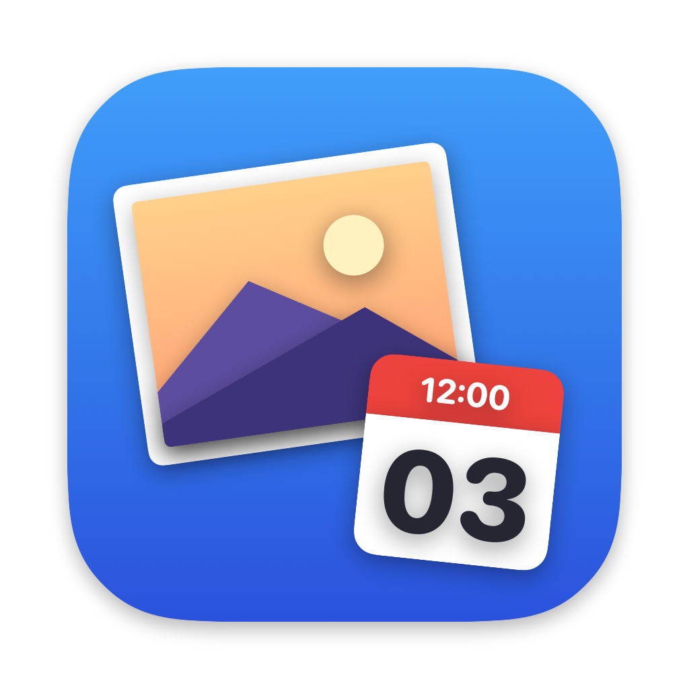

# 撮影日セッター (PhotoDater)



写真フォルダをドラッグ&ドロップすると、フォルダ名 `yymmdd` の日付を撮影日として EXIF に書き込む macOS アプリ。

## 機能

- フォルダ名が `yymmdd`(例: `240503`、`240503_運動会`)なら自動で日付を判定
- 日付でないフォルダ名は手動で日付を指定
- 複数フォルダ対応(写真のない親フォルダを入れると中のサブフォルダを個別に追加)
- 時刻は 12:00 JST(+09:00)が基本、変更可
- 書き込み前の確認画面(現在の撮影日 → 新しい撮影日 / 新しいファイル名を一覧表示)
- ファイル名の変更(任意)。テンプレート変数:
  - `{yymmdd}` `{yyyy}` `{yy}` `{mm}` `{dd}` 日付
  - `{nn}` `{nnn}` 連番(RAW+JPEG など同名ファイルは同じ番号)
  - `{name}` 元ファイル名、`{folder}` フォルダ名
  - 初期値 `{yymmdd}_{nn}_{name}` → `240503_01_IMG_1234.jpg`
- バックアップ(`*_original`)を残すオプション

書き込むタグ: `DateTimeOriginal` / `CreateDate` / `ModifyDate` と `OffsetTime*`(+09:00)。動画は UTC に変換して記録。

対象: jpg / heic / png / tiff / webp / 各種 RAW / mov / mp4 / m4v(フォルダ直下のみ)

## 必要なもの

- macOS 14 以降(Apple Silicon)
- [ExifTool](https://exiftool.org/): `brew install exiftool`
- Swift(Xcode Command Line Tools)

## ビルド

```bash
./build.sh
open "build/撮影日セッター.app"
```

アイコンを作り直すとき:

```bash
swift Tools/make_icon.swift . && iconutil -c icns build/AppIcon.iconset -o Resources/AppIcon.icns
```
